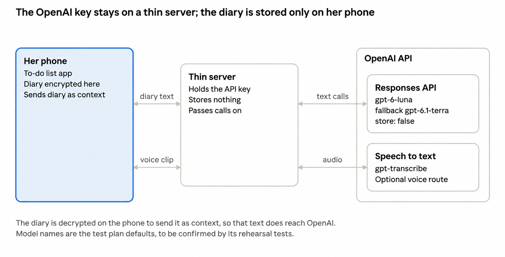

# Eira: architecture

Three parts: the iOS app, a thin server, and the OpenAI API. The diagram below is from the brief. The models shown in the diagram are the test-plan models. The team has decided the models; see `AI_CONTRACTS.md`.

## 1. iOS app (DECIDED, C1)

| Topic | Requirement |
|---|---|
| Stack | SwiftUI. No third-party iOS libraries. Built in layers (see section 2). |
| Storage | Two stores on the phone. **Secret store:** her entries, events and report draft, encrypted with CryptoKit AES-GCM. **Cover store:** ordinary to-do tasks, including the unrelated tasks generated for diary entries (DECIDED, C11). It is separate from private encryption, because the cover must show its contents before the actual app is opened. It holds nothing sensitive and no link back to any entry. |
| Key | OPEN after C11. The literal task title `eira` opens the actual app but must not be used as an encryption secret. The previous secret-name derivation no longer applies. The team must choose replacement key management before encrypted storage is built. Keep task-trigger handling and key management in separate files. The base provides an in-memory store only. |
| File protection | iOS Data Protection on both stores. |
| Backups | Secret store excluded from iCloud and device backup. The research notes list compromised iCloud accounts as a threat. |
| Notifications | None. Do not request the permission. |
| Photos | No Photos access. No camera capture. |
| Inactive | When the app goes inactive, hide content so the app-switcher snapshot shows the cover. |
| Background | Lock when the app goes to the background. On return, show the cover. |
| Delete everything | Removes the secret store and any key material kept for it (such as a salt). The cover store stays, so the app still looks the same afterwards. |
| Voice | Record to a temporary file, upload it to the server, delete the file right after, whether or not the call succeeded. |
| Quote check | Runs on the phone in plain code (see `AI_CONTRACTS.md`). |

Decrypted text exists in memory only while unlocked. It is dropped on lock.

## 2. App layers and Android (DECIDED, C1)

iOS is the demo medium because the whole team uses iOS. No Android work is in scope. The app is split into five folders so that a later Android version is feasible. This is plain folder separation. Add no abstractions beyond it, no Android code, and no cross-platform framework.

| Layer | What it holds | Rule |
|---|---|---|
| UI | Screens, written in SwiftUI only. | Calls the layers below. Holds no rules. |
| Core rules | The quote check, allowed-use filtering, and draft field states (empty, from her words, edited by her). | No UI imports and no platform imports. |
| Storage | The secret store and the cover store, behind one small interface. | The rest of the app reads and writes records only through that interface. |
| Server client | Calls to the thin server. | Sends no prompt and no schema. |
| Platform services | Voice recording, encryption, and the SAPA form web view. | The only place that touches iOS system frameworks other than SwiftUI. |

**What carries over to Android**

| Part | On a later Android version |
|---|---|
| Server, prompts, schemas, FAQ, fixtures, SAPA field list, data model | Reused as is. |
| UI and platform services | Rewritten. |
| Core rules | Ported one for one. |

## 3. Thin server (DECIDED)

| Topic | Requirement |
|---|---|
| Role | Holds the OpenAI key, the prompts, the output schemas and the approved FAQ text (`FAQ_APPROVED.md` only). `LEGAL_FAQ.md` and `LEGAL_REVIEW_LOG.md` are never loaded and never bundled with the server. Passes calls on. |
| Database | None. |
| Logging | Never log request or response bodies. Whether the host logs anything else by default (URLs, status codes) is UNVERIFIED. Check before the demo. |
| Endpoints | Task-specific: extract, ask, draft, transcribe. The phone never sends a prompt or a schema. |
| Runtime | Vercel functions on Node with the `openai` package. This is the default from the test plan. Vercel steps in the test plan are from memory (UNVERIFIED). |
| Domain | Must not contain the Indonesian word for "report". This includes the Vercel project name, which sets the default address. |
| Auth | A simple shared app token sent by the app. The app reads the server address and the token from one config file. Ceiling: hackathon only, not real authentication. |

Environment variable names (suggested in the test plan, not required by the SDK):

| Name | Use |
|---|---|
| `OPENAI_API_KEY` | The key. Server only. Never in the app, never in the repository. |
| `OPENAI_TEXT_MODEL` | Primary text model. |
| `OPENAI_FALLBACK_MODEL` | Fallback text model. |
| `OPENAI_TRANSCRIBE_MODEL` | Speech-to-text model. |

The app token's variable name is chosen on the day. The test plan also names `OPENAI_REALTIME_MODEL`, but Eira does not use live voice, so it is not needed.

## 4. OpenAI API

Responses API with Structured Outputs for text. The transcriptions endpoint for voice. Details, models and schemas are in `AI_CONTRACTS.md`.

## 5. Data model (field tables)

Entry, Event and ReportDraft live in the secret store. Cover tasks live in the cover store. Nothing here is stored on the server.

**Entry**

| Field | Meaning |
|---|---|
| id | Unique id. |
| created_at | From the phone clock. This is the date shown on the timeline. |
| text | Her exact text. Never edited by the app. For voice, the transcript. |
| source | `text` or `voice`. |
| allowed_uses | Three flags: personal timeline, legal guidance, report. Default: all on (PROVISIONAL, open decision 1), kept as one setting. Turning off personal timeline hides the entry from the timeline only; it stays stored and can be deleted. |

**Event** (derived from one entry; inherits that entry's allowed uses)

| Field | Meaning |
|---|---|
| entry_id | The entry it came from. |
| when_text | When, exactly as she wrote it. Can be empty. |
| what_happened | One or two sentences in her words. |
| injuries | Physical effects she mentioned. Can be empty. |
| witnesses | List of names or descriptions she gave. Can be empty. |
| quote | Exact substring of the entry text. |
| pkdrt_type | `fisik`, `psikis`, `seksual`, `penelantaran`, or `tidak_yakin`. An editable suggestion. |
| user_edited | True once she changes the event or its type. |

**ReportDraft field** (one per SAPA field in `SAPA_FORM.md`)

| Field | Meaning |
|---|---|
| field_name | The SAPA field. |
| value | The value, or empty. For dropdowns, an exact allowed value. |
| quote | The words from her text that support the value. Empty if she typed or chose the value herself. |
| source_entry_id | The entry containing the quote. Set by plain code, not by the AI. |
| status | `empty`, `from her words`, or `edited by her`. |

**Cover task** (cover store, DECIDED C11)

| Field | Meaning |
|---|---|
| id | Local unique id. |
| title | Ordinary task text. A user-added title of exactly `eira` is consumed by the access flow and never stored as a task. |
| created_at | From the phone clock. |
| is_completed | Whether the task is complete; starts false. |

User-added tasks and the unrelated cover task returned by extract use this same record. No entry id, source marker, or link back to a private entry is stored. Generated task titles never equal `eira`.

Her Stage 2 messages: DECIDED default (see `PRODUCT.md`, open decision 6). Store her messages as entries marked as questions, never extracted into timeline events. They can support a report only when allowed for report. AI replies are never quote sources. Entry therefore also carries `kind`: `story` (default) or `question`.

## 6. What leaves the phone

| What | When | Goes to | Kept |
|---|---|---|---|
| The new entry's text | Stage 1, extract call | Our server, then OpenAI | Server: nothing. OpenAI: `store: false`, but abuse-monitoring logs can keep prompts and responses up to 30 days. |
| Her question, the Ask chat so far, and entries allowed for legal guidance (with their events) | Stage 2, ask call | Same | Same |
| Entries allowed for report (and her allowed Stage 2 messages) | Stage 3, draft call | Same | Same |
| A voice clip | Stage 1, transcribe call | Our server, then OpenAI transcription | Phone: deleted right after. OpenAI: per the test plan, no abuse-monitoring retention and no application state for transcription. |
| Report content | Only when she presses send on the real SAPA form, and only on a build whose target is real | The web view fills the form from her draft. The form's own send button sends it to SAPA, and she presses it. On the mock target, or in a Debug or demo-branch build, nothing leaves the phone. UNVERIFIED: whether the live page sends anything before she presses send (for example autosave). | Phone: the draft stays in the secret store. SAPA: UNVERIFIED. |

Never sent: entries limited from that use, her key or cover tasks. The `eira` access trigger is handled locally.

The decrypted text goes through our server to OpenAI, so "encrypted on her phone" does not mean the text never leaves the phone. Modified Abuse Monitoring (which would remove the 30-day copy) needs OpenAI approval. Status: OPEN. Ask the organisers on the day.

## 7. iOS checks to run (all UNVERIFIED)

Check these on iOS, on a real iPhone where possible:

- App switcher: the snapshot shows the cover, with and without the real app open.
- Search and suggestions: neither the app, a cover task, nor any entry text appears in Spotlight or Siri suggestions.
- Keyboard learning: the iOS keyboard does not learn diary words and suggest them in other apps. This includes private diary text. The fixed `eira` trigger is not a secret. Keyboard behaviour remains UNVERIFIED.
- Backup exclusion: the secret store is absent from a device or iCloud backup.

## 8. Libraries and services (DECIDED)

| Kind | Item | Use |
|---|---|---|
| iOS system frameworks | SwiftUI | UI |
| iOS system frameworks | CryptoKit | Encryption |
| iOS system frameworks | CommonCrypto | Conditional on the OPEN key-management decision; no implementation in the base |
| iOS system frameworks | AVFoundation | Voice recording |
| iOS system frameworks | WebKit | SAPA form web view |
| Server library | `openai` npm package on Node | Calls to OpenAI |
| External services | OpenAI API | Text and speech-to-text |
| External services | Vercel | Hosts the thin server |
| External services | SAPA 129 site | Real target only |
| Tools | Xcode, Codex | Building the app |

No third-party iOS libraries. No database. Add nothing else without asking the team.

## 9. Distribution

For the hackathon, run from Xcode on a simulator or a team iPhone. After the event there is a risk: NNEDV (2017, per our notes) says the Apple App Store restricts disguised apps, or requires the real purpose in the description, which can defeat the disguise. UNVERIFIED for 2026.
