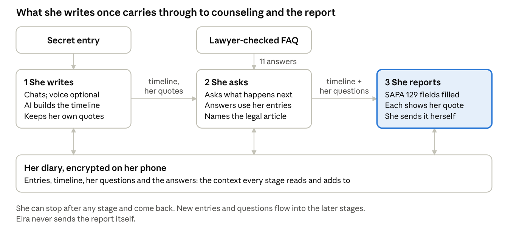
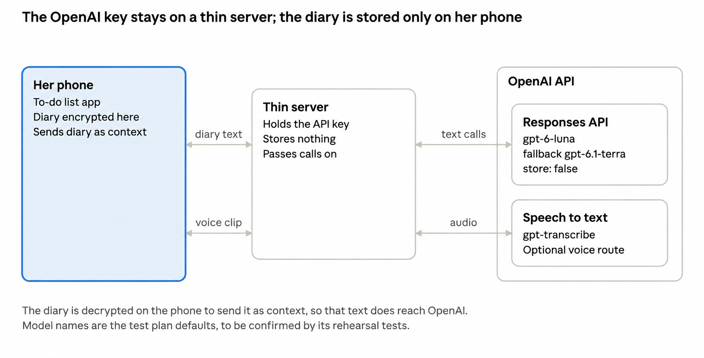

Copy of the Eira project brief, lightly edited. Later decisions are in PRODUCT.md.

# Eira: Project Brief

Nov 5, 2026 · @k

## What Eira is, in one read

Eira is an app disguised as a to-do list in which what an Indonesian wife writes once carries through to legal counseling and, if she chooses, to a report to SAPA 129. This brief describes the planned product. SAPA 129 is the national hotline run by the Ministry of Women's Empowerment and Child Protection (KemenPPPA).

the flow · 3 stages sharing one diary

Each arrow between stages names what is handed on, and the diary underneath is what every stage reads from and adds to.

Eira is for women who are not ready to report. To anyone glancing at the phone it looks like a to-do list. Adding a new task named exactly `eira` opens the actual app (C11 in `PRODUCT.md`).

Inside there is one flow, and each stage feeds the next. She writes in a chat, and the AI builds a dated timeline from her words. When she asks "what happens to me?", the answers draw on that timeline and a lawyer-checked FAQ, and they name what happened using the relevant article of the domestic violence law (UU PKDRT, UU 23/2004). When she is ready, the report to SAPA 129 is filled from everything she has already said.

She can stop at any stage and return later. Writing more or asking more makes the later stages better informed, so she never has to explain twice. Eira never sends a report by itself: she reviews the draft and sends it herself.

The example user, Sari, is a design persona built from national survey data, not a real person. She is 32, lives in Bekasi, and was made to quit work. She is insulted daily, controlled over money, and has been hit several times.

## Background: the real problem

Most Indonesian wives who suffer partner abuse never report it, and 57.1% of those hit or sexually assaulted by a husband told no one. All figures here are as cited in our research notes, from the 2024 national women's survey (SPHPN 2024, run by KemenPPPA and the statistics agency BPS with UNFPA support).

| Fact | Figure |
|---|---|
| Ever-partnered women with at least one of five forms of partner abuse | 41.2% lifetime, 25.4% in the past year |
| Most common forms | Controlling behaviour 30.3%, economic abuse 15.0% |
| Physical or sexual violence by a husband | 10.4% lifetime, 3.0% past year |
| Told no one, among women hurt physically or sexually by a husband | 57.1% |
| Ever went to any institution | 11.3% |
| Reported to a regional protection unit (UPTD PPA) | 0.2% |
| Top reasons for not reporting | "Not serious" 43.6%, family shame 19.1%, fear of not being believed 18.7% |
| Most common economic abuse: husband makes her quit or refuse paid work | 11.4% lifetime |

The pattern is mostly words and money, not constant beatings. Many women do not call it abuse, want to keep the marriage and the children, and tell their own mother first: 56.6% of those who told anyone told a parent.

**Who Sari is.** Sari is a design persona assembled from these figures, so each trait traces to a source. The notes label her in-laws living with her as a design assumption, and her husband checking her phone as a threat-model assumption, because they found no Indonesian prevalence data for either.

**What exists today.** SAPA 129 is a real intake channel by phone (129) and WhatsApp (08111-129-129). It starts a referral to a regional unit, not an arrest. The notes found no Indonesian tool that gives a woman a private place to keep a record before she is ready to report.

The research notes also record a design lesson. In a US randomised trial of 720 women (myPlan, as cited), a safety decision aid reduced decisional conflict but did not reduce violence. We therefore claim Eira helps a woman understand her options. We do not claim it keeps her safe.

## Why this solution

Eira disguises itself because the likeliest reader of her phone is someone she lives with, and a private place only helps if it does not draw attention. Studies cited in our research notes find that abusers mostly look through ordinary screens rather than install spyware (Freed et al. 2018). In another study, 10 of 15 survivors said the abuser physically controlled their phone (Matthews et al. 2017).

A disguise lowers the chance of casual discovery. It does not stop a determined search, spyware, or a husband who controls her Google account. The notes say this plainly, and Eira makes no stronger claim.

| Choice | Why | Evidence strength, per our notes |
|---|---|---|
| Serve women not yet ready to report | 57.1% told no one; 43.6% think the abuse is "not serious" | Moderate |
| To-do-list cover | A working task list is the founder's choice on 7 Nov 2026 (C11). Its fit has not been tested. | Unmeasured |
| Text first, voice optional (transcribe, discard the audio) | A shared house with in-laws makes speaking aloud risky. Stored audio can leak, as in the 2020 Aspire app leak | Weak to moderate for text; none for voice |
| Records encrypted on her phone; our server keeps no copy | A server copy of her records is the kind of store that exposed Aspire users. Text she sends to the AI still reaches OpenAI; see the limits below | Moderate |
| "What happens to me?" answers from a lawyer-checked FAQ | Her fears are practical: income, children, arrest | Strong as an analogue (myPlan trial), small effect |
| Draft only, never auto-send | She keeps control of pace and of what is sent | Moderate (consensus frameworks) |
| Tell-it-once report | The government's June 2026 "tell it once" pilot names retelling as a core failure, as cited | Moderate for the problem; none for outcomes |

**Versus what exists.** The notes compare ten tools. SAPA 129 and the public complaints portal SP4N-LAPOR! are reporting doors, with no private record and no disguise. Sophia (Switzerland) pairs a chatbot with an evidence vault but has no Indonesian law and no link to SAPA. rAInbow (South Africa) has AI chat but no log or report.

The notes report no Indonesian tool combining a disguised private record, a plain-language legal explainer, and a handover to SAPA 129. They also say a 10-minute Play Store check to confirm this is still open. Eira is a front door to SAPA 129, not a rival to it.

## How it works

Eira is one flow in which her own words are written once and then reused at every stage. Here is the walk-through, as designed, for Sari.

**Entry.** The app opens as a working to-do list. Adding a new task named exactly `eira` opens the actual app. No user-chosen secret-name setup is needed. C13 opens the private area directly after the exact trigger, with no extra passphrase. Encryption uses a key held by this phone. Anyone using the unlocked phone who knows the trigger can open the records. Her records are encrypted on her phone, and the research notes call for a fast "delete everything" control.

**Stage 1: she writes.** She chats in text, or optionally speaks. Speech is turned into text and the audio is thrown away. The AI builds a dated timeline from what she says: when, what happened, any injuries or witnesses. Each event keeps a quote of her own words, and nothing is added that she did not say. For each real entry Eira also writes an unrelated, ordinary cover task, so the cover remains a working to-do list. The task contains nothing from her entry and has no link back to it.

**Stage 2: she asks.** When she asks "what happens to me?", the AI answers from a lawyer-checked FAQ and from her own timeline together. The FAQ has 11 answers, on questions such as whether SAPA 129 means an arrest, what happens to the children, what proof she needs, and whether it costs money. Because the AI already holds her entries, she does not have to explain again. It names what happened using the relevant UU PKDRT article, and says it is not sure when an entry is unclear. The notes also recommend a danger check and a "what matters most" step before advice.

**Stage 3: she reports, if she chooses.** The report uses the same fields and dropdown values as the real SAPA 129 form, so it can be pasted into that form. It is filled from her timeline and from what she has said while asking. Each field is shown next to the words it came from. A field with no source in her words stays empty. She reviews it, edits it, and sends it herself. Eira never sends it.

| Stage | She does | It produces | The next stage uses it as |
|---|---|---|---|
| Write | Chats about what happened | Dated timeline with her own quotes | Context for counseling and the report |
| Ask | Asks what the law means for her | Answers naming the UU PKDRT article | Added context for the report |
| Report | Reviews the draft and sends it | A SAPA 129 report, each field traced to her words | Nothing; she decides whether to send |

She can stop after any stage. When she returns to write or ask more, the later stages draw on the new material, so a draft made earlier can be refreshed rather than started again.

## Execution

Eira is planned as a phone app with encrypted local storage, a thin server that holds the OpenAI API key, and OpenAI's API for text and speech-to-text. The diagram below shows the parts and what passes between them.

planned architecture · phone, thin server, OpenAI API

The phone keeps the encrypted diary and sends text or a voice clip to the thin server. The server adds the API key, calls OpenAI's Responses API with Structured Outputs or its speech-to-text endpoint, and returns the answer without keeping a copy.

**Decisions and their reasons.** Each row traces to the research notes, the OpenAI test plan, or a team decision.

| Decision | Why | Alternative not chosen |
|---|---|---|
| One persona: a wife not yet ready to report | The survey data: 57.1% told no one, and 43.6% think the abuse is "not serious" | A general companion for anyone who has seen violence |
| To-do-list disguise | Casual discovery is the documented threat; C11 records the founder's cover choice | A calculator-style cover |
| The diary is shared context across the whole flow | She tells it once. Entries feed counseling, and both feed the report. Our notes cite retelling as a core failure of the current system | Separate tools that each ask her to start over |
| Voice is optional; audio is transcribed and discarded | A shared home makes speaking aloud risky, and stored audio can be found or leaked | Voice-first with stored recordings |
| No server database; records encrypted on her phone | A server copy of her records is the kind of store that exposed Aspire users | Keeping reports on our server |
| Never auto-send | She decides the pace and what goes to SAPA 129 | Automatic submission |
| Mirror the real SAPA form's fields and dropdown values | The draft can be pasted into the real form | A free-text summary |
| Every report field carries a quote from her words | "No source, no field": plain code rejects any field whose quote is not in her text (test plan, test T4) | Letting the AI fill fields without a source |
| OpenAI API for text and speech-to-text | OpenAI is the hackathon's co-organiser, per the proposal. The test plan sets out the models, key handling and data-retention settings | Another provider's models |

**How Codex will be used.** The proposal says teams get Codex access at the event and build the project during it. Open question for the team: how will Codex be used in the build?

## Who benefits, limits, and what comes next

The intended beneficiary is a woman like Sari, and the benefit we can defend is understanding her options, not safety. No user outcome has been measured for Eira. The closest tested tool, myPlan, reduced decisional conflict and changed no violence outcome, as cited in our notes.

SAPA 129 is a second beneficiary. Our notes cite the government's own pilot naming repeated retelling as a core failure, and a complete, dated draft she approves addresses it. Reach is limited: only 62% of women owned a phone in 2023 against 71% of men (GoodStats citing BPS, as cited), and Android holds about 77% of the market.

**Known limits**

- A disguise lowers casual discovery only. Spyware, a controlled Google account, or a forced unlock defeats it, and discovery can escalate abuse (NNEDV, as cited).
- The AI can be wrong about the law at the worst moment. FAQ answers 4, 7 and 11 (penalties and restorative justice, protection orders, withdrawing a complaint) rest on 2026 code changes checked only in secondary sources, and no lawyer has reviewed them.
- Reporting carries real risk. Police often push settlement, and 18 of 105 legal cases Komnas Perempuan tracked in 2025 involved criminalising the wife, as cited. Eira must say so.
- The device tests listed in our notes, run on a real phone, have not been done. Nor has any test of how well speech-to-text handles Indonesian mixed with Javanese.
- No user test has been run with people close to the persona.

**What leaves the phone.** For the counseling and report stages, her diary text is decrypted on the phone and sent through our server to the OpenAI API as context. So "encrypted on her phone" does not mean the text never leaves the phone. Our server keeps no copy, and the test plan has every text call set not to store the response (store: false).

Per the test plan, OpenAI can still keep prompts and responses in abuse-monitoring logs for up to 30 days, and the in-app privacy text should say so plainly. The test plan reports that speech-to-text requests leave no retained copy. Open question: can the team get Modified Abuse Monitoring, which needs OpenAI's approval, on its account?

**What comes next**

The proposal requires all code to be written on the day, so the work before 7 Nov is rehearsal, content and checks, and the build follows the flow.

1. Before 7 Nov: run the rehearsal tests in the OpenAI test plan (structured output, legal tagging, quote check, voice, privacy settings, cost).
2. Before 7 Nov: a lawyer, ideally at LBH APIK Jakarta, reviews the flagged FAQ answers, and the device tests run on a real phone.
3. On 7 Nov, entry: the to-do cover, the `eira` add-task access flow, and encrypted storage on the phone (C13: a device-held encryption key, no extra passphrase).
4. On 7 Nov, stage 1: the writing chat that builds the timeline with quotes, with optional voice.
5. On 7 Nov, stage 2: the counseling chat that uses the FAQ and the timeline together and names the UU PKDRT article.
6. On 7 Nov, stage 3: the SAPA 129 draft with a quote behind each field, a review screen, and sending by her alone.
7. After 7 Nov: a first test with people close to the persona.

## How this maps to the six judging criteria

The case rests on the research and on a flow in which one diary feeds counseling and the report. The table gives, for each criterion, how Eira answers it and what is still missing.

| Criterion | How Eira answers it | Remaining gap |
|---|---|---|
| Problem and solution fit | National survey figures on non-reporting; a sourced persona; a comparison of ten existing tools; every design choice rated for evidence | No user test yet. Evidence that a disguise or the diary helps is none to weak, per our notes |
| Build quality | A flow where each stage's output is the next stage's input; a quote behind every report field, checked by plain code; encrypted local records; never auto-send | The build happens on 7 Nov. Results of the OpenAI rehearsal tests are not yet recorded in our notes |
| Insight and originality | A private waiting room before the report, and one diary reused for counseling and for a report she tells once, from her own words | Each part exists abroad (Sophia, rAInbow, myPlan, Aspire). The claim is the combination for Indonesia, and the Play Store check is not yet done |
| Real-world value | A sized problem (25.4% past-year partner abuse) and a named gap in the reporting system | No measured benefit. The best analogue showed no drop in violence |
| Alignment with build direction | The proposal enters the Deep Domain AI track: Indonesian domestic-violence law (UU 23/2004) and the SAPA 129 process | Part of the legal content awaits lawyer review. Confirm that the "build directions" on the six-criteria slide are the three tracks |
| Use of Codex | The proposal states teams get Codex access at the event | Open question: how will Codex be used in the build? |

**Sources.** All as cited in our research notes; we have not opened these pages ourselves.

- [SPHPN 2024 leaflet](https://indonesia.unfpa.org/sites/default/files/pub-pdf/2024-10/SPHPN%202024_KemenPPPA_UNFPA%20Indonesia.pdf) and [SPHPN 2024 In-Depth Analysis](https://indonesia.unfpa.org/sites/default/files/pub-pdf/2026-01/IN-DEPTH%20ANALYSIS_SPHPN%202024_EN.pdf): prevalence, non-reporting, reasons, economic abuse.
- [CATAHU 2025, Komnas Perempuan](https://komnasperempuan.go.id/catatan-tahunan-detail/catahu-2025-menguatkan-data-mengatasi-kerentanan-mendesak-negara-bersikap-untuk-keadilan-korban): the 18 of 105 figure.
- [UU 23/2004 (PKDRT), BPK](https://peraturan.bpk.go.id/Details/40597/uu-no-23-tahun-2004): legal articles in the FAQ.
- [Freed et al. 2018](https://www.classes.cs.uchicago.edu/archive/2020/winter/20370-1/readings/Stalkers.pdf) and [Matthews et al. 2017](https://mshelt.onl/p/matthews_et_al_2017.pdf): how abusers use phones.
- [Eden et al. 2015](https://pmc.ncbi.nlm.nih.gov/articles/PMC4380709): the myPlan decision aid; Glass et al. 2017 reports the 720-woman trial.
- [NNEDV on building safety-first apps](https://techsafety.org/blog/2017/8/30/so-you-wanna-build-an-app-safety-first): how disguises fail.
- [TechCrunch on the 2020 Aspire leak](https://techcrunch.com/2020/06/25/aspire-app-dr-phil).
- [Hukumonline on restorative justice in the new KUHAP](https://www.hukumonline.com/klinik/a/restorative-justice-dalam-kuhap-baru-lt519065e9ed0a9).
- [GoodStats citing BPS, phone ownership](https://goodstats.id/article/megawati-tak-punya-handphone-perempuan-lebih-sedikit-bagian-dari-minoritas-populasi-oQ1Kc) and [StatCounter, Android share](https://gs.statcounter.com/os-market-share/mobile/indonesia).
- [Event page named in the proposal](https://seaxopenai-hackathon-id.sea.com).

Internal source: the team's OpenAI API test plan (2 Nov 2026), for model names, key handling and data retention.
